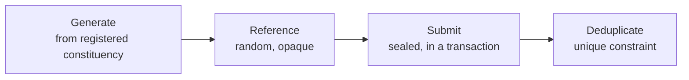

# Ballot Lifecycle

A ballot moves through four stages. Each has one rule that must not be bent.



## 1. Generate

The ballot is built from the voter's registered constituency. Not the remote polling centre, not the request body. This is the Core Rule — see `constituency-invariant` for the full treatment and the regression test.

Before generating, confirm in one transaction-safe read: the election is active, the voter is eligible, and — when the voter is at a remote polling centre — an approved remote polling assignment exists for this voter, this election, and this centre.

## 2. Reference

Every submitted ballot carries an opaque ballot reference: `crypto.randomBytes(16).toString('hex')`. Never derived from voter data, never sequential. See `ballot-secrecy`.

## 3. Submit

Sealing uses AES-256-GCM with a fresh nonce — see `ballot-integrity`.

The submission writes two rows on opposite sides of the secrecy boundary, and they must land together or not at all:

```ts
await prisma.$transaction(async (tx) => {
  // identity side: records THAT the voter voted
  await tx.voterElectionStatus.create({ data: { voterId, electionId, hasVoted: true } });

  // choice side: records WHAT was chosen, with no link back
  await tx.submittedBallot.create({
    data: { ballotReference, electionId, constituencyId, nonce, ciphertext, tag },
  });
});
```

If the first write fails on the unique constraint, the transaction rolls back and no ballot is stored. If the transaction were skipped, a crash between the two writes would either lose a ballot or let the voter vote twice.

## 4. Deduplicate

One ballot per voter per election. The guarantee lives in the database.

```prisma
model VoterElectionStatus {
  voterId    String
  electionId String
  hasVoted   Boolean
  @@unique([voterId, electionId])
}
```

A service-level check is not a guarantee:

```ts
// ❌ BAD — two concurrent requests both read false, both proceed
const existing = await prisma.voterElectionStatus.findUnique({ where: { voterId_electionId } });
if (existing?.hasVoted) throw new AlreadyVotedError();
await submitBallot(...);
```

The read-then-write gap is a real race, not a theoretical one: a voter double-clicking submit is enough to hit it.

Keep the early check for a fast, friendly error, but treat the constraint as the actual enforcement:

```ts
try {
  await prisma.$transaction(...);
} catch (e) {
  if (isUniqueConstraintViolation(e, 'VoterElectionStatus_voterId_electionId_key')) {
    throw new AlreadyVotedError();
  }
  throw e;
}
```

Translate the violation to a domain error in the repository. The constraint name must never reach the API response.

## Required tests

- A ballot generated for a voter with a remote polling assignment carries the registered constituency and its candidates.
- A second submission for the same voter and election is rejected with `AlreadyVotedError`.
- **Two submissions fired concurrently for the same voter and election: exactly one succeeds, exactly one row exists in each table.** Run the two promises in parallel against a real PostgreSQL test database — an in-memory fake or a mocked Prisma client cannot exercise the constraint, so this test is meaningless without the real database.
- A submission that fails partway leaves no row on either side.
- Submission to a closed or not-yet-active election is rejected.
- Submission without an approved assignment, at a remote polling centre, is rejected.

## Counting

Opening ballots for counting happens only inside the Election Simulator, only after the election is closed, and only through `openBallotForCounting`. Results are aggregates per candidate per constituency. See `election-simulator`.
