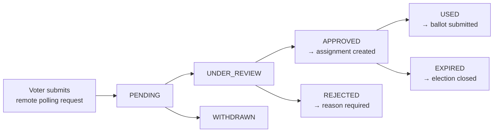

# Remote Polling Workflow

A geographically mobile voter asks to vote somewhere other than their home polling centre. An officer reviews it. If approved, the voter gets a remote polling assignment.

What the assignment grants is narrow: permission to appear at one named polling centre for one named election. It never touches the registered constituency or the ballot — see `constituency-invariant`.

## The flow



States, transitions, and who may perform each: [state-machine.md](state-machine.md).

## Transitions are explicit

Never assign a status by writing a string into an update. Route every change through one transition function that rejects illegal moves.

```ts
// ❌ BAD — nothing stops a REJECTED request becoming APPROVED
await prisma.remotePollingRequest.update({ where: { id }, data: { status: 'APPROVED' } });

// ✅ GOOD — one gate, one place to audit, one place to test
await remotePollingService.transition(id, 'APPROVED', { actor, reason });
```

The transition function validates the move against the table in [state-machine.md](state-machine.md), checks the actor's role, writes the new status and the assignment in one transaction, and emits the audit record. A transition that is not in the table throws.

## Approval creates the assignment

Approval is not a status flip. It produces a remote polling assignment, and the two writes are one transaction — an approved request with no assignment would let a voter through with nothing to verify against.

The assignment records the voter, the election, and the approved polling centre. It records no constituency. If you find yourself wanting a constituency field on the assignment, that is the Core Rule being violated; stop and re-read `constituency-invariant`.

Rejection requires a reason, stored and shown to the voter.

## Verify again at the polling centre

An approval granted days ago is not a licence to vote now. Immediately before generating a ballot, re-check, in the same transaction that submits:

- The election is active.
- The voter is still eligible — `eligibility-verification` has not since been revoked.
- An assignment exists for **this voter, this election, and this polling centre**. A valid assignment for a different centre is not valid here.
- The voter has not already voted.

```ts
// ❌ BAD — centre not checked; any approved voter votes anywhere
const assignment = await findAssignment({ voterId, electionId });
if (!assignment) throw new NoAssignmentError();

// ✅ GOOD
const assignment = await findAssignment({ voterId, electionId, pollingCentreId });
if (!assignment) throw new NoAssignmentError();
```

After a successful submission the assignment moves to `USED`, in that same transaction.

## Rules

- One active request per voter per election. Enforce with a partial unique constraint, not an application check.
- A voter may only read, submit, and withdraw their **own** requests. Authorize on the authenticated voter, never on an ID from the request body.
- Only a Verification Officer approves or rejects. See `role-authorization`.
- An officer may not approve their own request if they also hold a voter record.
- Requests cannot be submitted after the election opens, and cannot be approved once it closes.
- Every transition writes an audit record naming the actor. See `audit-trail`.

## Required tests

- Each legal transition in [state-machine.md](state-machine.md) succeeds for an authorized actor.
- Each illegal transition is rejected — in particular `REJECTED → APPROVED` and `USED → APPROVED`.
- A Polling Centre Officer and a Voter are both refused on approve.
- Approval creates exactly one assignment; a failure mid-transaction creates none.
- A voter with an assignment to centre X is refused at centre Y.
- A second active request for the same voter and election is refused.
- A voter cannot read or withdraw another voter's request.
